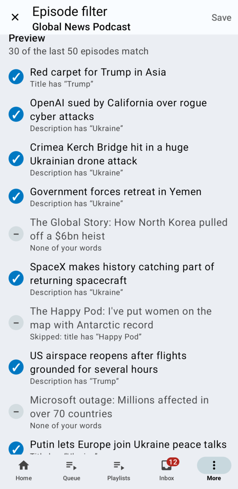

# Episode filter

An episode filter decides, for one podcast, which episodes are downloaded automatically and which ones playlists can use. It does not hide anything from the episode list, the Inbox or the queue, and it does not affect downloads you start yourself.

AntennaPod Mix offers two filters. Choose one in Settings → Downloads → Automatic download → **Episode filter style**:

| | Basic | Advanced |
|---|---|---|
| Works with the official AntennaPod | Yes | No, AntennaPod Mix only |
| Words to include | Yes | Yes |
| Words to skip | Yes, but not together with include words | Yes, together with include words |
| Any or all of the words | Any | Any or all |
| Where it looks | Title | Title, description, or both |
| Whole words only | No | Optional |
| Length | Minimum | Minimum and maximum |
| Preview | No | Yes, live |

Both filters are kept side by side, so switching between Basic and Advanced never loses anything. The first time you open the advanced filter for a podcast, it starts from that podcast's basic words.

## Basic filter

This is AntennaPod's own filter. In a podcast's settings, turn on **Download automatically**, then open **Episode filter**. Choose whether your words include or exclude episodes, list them (put a phrase in quotes: `"bonus episode"`), and optionally set a minimum length in minutes. Words are matched anywhere in the title, ignoring upper and lower case.

## Advanced filter

With **Advanced** selected, a podcast's **Episode filter** opens a full screen. It is shown even when automatic download is off for that podcast, because it also applies to playlists.

- **Only episodes with:** words or phrases to include. Choose **Any of these** or **All of these**. Leave empty to include everything.
- **Skip episodes with:** words or phrases to skip. Skipping wins when an episode matches both.
- **Look for words in:** title, description, or both.
- **Whole words only:** "war" no longer matches "award". Off by default.
- **Length:** at least and/or at most a number of minutes. Leave a field empty for no limit. An episode whose length is not known yet is not filtered by length.

The **preview** at the bottom shows the last 50 episodes of the podcast, whether each one matches, and why ("Title has 'Ukraine'", "Skipped: description has 'bonus'", "Too short"). It updates as you edit. Tap **Save** to keep your changes, or ✕ to leave without saving.

The podcast's settings then sum up the filter, for example: *With any of: "Ukraine", "climate" · without: "bonus" · titles and descriptions · at least 10 min*.

### Examples

- **Only the interviews:** include `interview`, look in titles.
- **Everything but the extras:** skip `bonus`, `trailer`, `"listener questions"`.
- **News about one topic, full episodes only:** include `climate`, look in titles and descriptions, at least 15 minutes.
- **Two topics at once:** include `election` and `Europe`, choose **All of these**.

## Filters and playlists

Playlist rules only pick episodes that pass the podcast's filter, whichever style you use. "3 most recent" then means the 3 most recent episodes that pass the filter.

Combined with a playlist's **Only downloaded episodes** option, a filter lets you build a playlist of exactly the episodes you want: the filter decides what gets downloaded, the playlist plays what is downloaded. See [Playlists](playlists.md#only-downloaded-episodes).

## Backups

The regular backup includes advanced filters. The export for the official AntennaPod leaves them out; the basic filter is part of AntennaPod's own data and carries over. See [Backups](backups.md).
