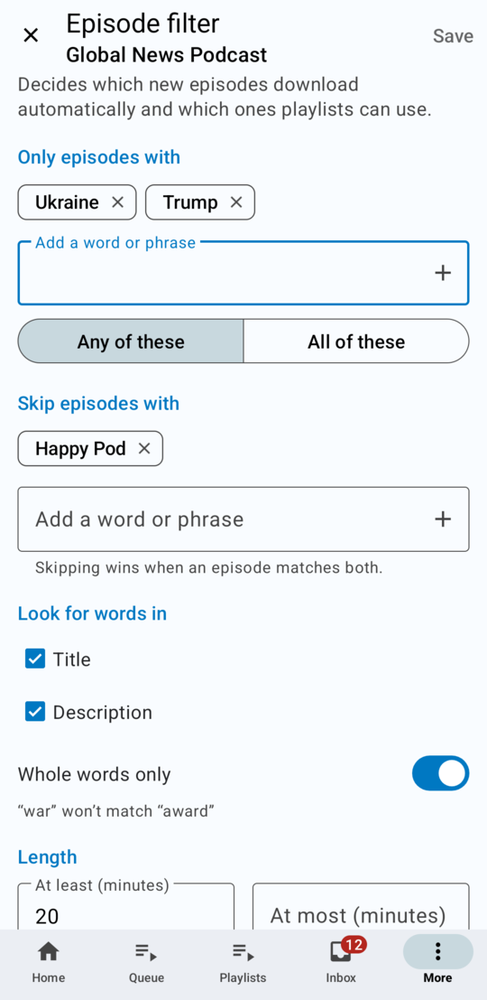

# Episode filter

An episode filter decides, for one podcast, which episodes are downloaded automatically and which ones playlists can use. It does not hide anything from the episode list, the Inbox or the queue, and it does not affect downloads you start yourself.

Castlist offers two filters. Choose one in Settings → Castlist features → **Episode filter style**:

| | Basic | Advanced |
|---|---|---|
| Works with the official AntennaPod | Yes | No, Castlist only |
| Words to include | Yes | Yes |
| Words to skip | Yes, but not together with include words | Yes, together with include words |
| Any or all | Any | Any or all, for each section |
| Where it looks | Title | Title, description, or both ("post") |
| How it matches | Contains | Contains, doesn't contain, starts with, ends with, is exactly |
| Whole words only | No | Optional, per condition |
| Upper/lower case and accents | Case ignored | Both ignored |
| Length | Minimum | Shorter than and/or longer than |
| Preview | No | Yes, live |

Both filters are kept side by side, so switching between Basic and Advanced never loses anything. The first time you open the advanced filter for a podcast, it starts from that podcast's basic words.

## Basic filter

This is AntennaPod's own filter. In a podcast's settings, turn on **Download automatically**, then open **Episode filter**. Choose whether your words include or exclude episodes, list them (put a phrase in quotes: `"bonus episode"`), and optionally set a minimum length in minutes. Words are matched anywhere in the title, ignoring upper and lower case.

## Advanced filter

With **Advanced** selected, a podcast's **Episode filter** opens a full screen. It is shown even when automatic download is off for that podcast, because it also applies to playlists.

The filter has two sections, each a list of conditions:

- **Only episodes where:** an episode must match these to be kept. Leave it empty to keep everything.
- **Skip episodes where:** an episode that matches these is skipped. Skipping wins when an episode matches both sections.

With two or more conditions in a section, choose **Any matches** or **All match** for that section.

Each condition is one line: **what to look at**, **how to match**, and a **value**.

- **Post** (the title or the description), **Title**, **Description**, or **Length**.
- For words: **contains**, **doesn't contain**, **starts with**, **ends with**, or **is exactly**. Upper and lower case and accents are ignored, so `integrale` matches "L'INTÉGRALE".
- **Whole word:** "war" no longer matches "award". Off by default.
- For length: **is shorter than** or **is longer than** a number of minutes. An episode whose length is not known yet never fails or triggers a length condition.

**Copy from another podcast** (in the ⋮ menu) loads another podcast's filter into the editor, so you can reuse a set of conditions. Nothing changes until you tap **Save**.

The **preview** at the bottom shows the last 50 episodes of the podcast, whether each one matches, and which condition decided it ("Skipped: post contains 'Riou'", "Kept: title contains 'interview'"). It updates as you edit. Tap **Save** to keep your changes, or ✕ to leave without saving.

The podcast's settings then sum up the filter, for example: *Only if any: title contains "Ukraine", title contains "climate" · Skip if any: post contains "bonus", length is shorter than 10 min*.

Filters made with an earlier version of Castlist are converted automatically: included words become "Only" conditions, skipped words and the length limits become "Skip" conditions.

### Examples

- **A block list, like FeedRinse:** under Skip, *post contains* `Riou`, *post contains* `Thoen`, *title doesn't contain* `L'intégrale`, with **Any matches**.
- **Only the interviews:** under Only, *title contains* `interview`.
- **Everything but the extras:** under Skip, *post contains* `bonus`, *title starts with* `Trailer`.
- **Full episodes about one topic:** under Only, *post contains* `climate`; under Skip, *length is shorter than* `15`.
- **Two topics at once:** under Only, *post contains* `election` and *post contains* `Europe`, with **All match**.

## Filters and playlists

Playlist rules only pick episodes that pass the podcast's filter, whichever style you use. "3 most recent" then means the 3 most recent episodes that pass the filter.

Combined with a playlist's **Only downloaded episodes** option, a filter lets you build a playlist of exactly the episodes you want: the filter decides what gets downloaded, the playlist plays what is downloaded. See [Playlists](playlists.md#only-downloaded-episodes).

## Backups

The regular backup includes advanced filters. The export for the official AntennaPod leaves them out; the basic filter is part of AntennaPod's own data and carries over. See [Backups](backups.md).
