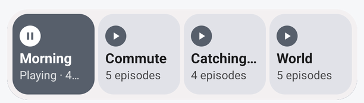
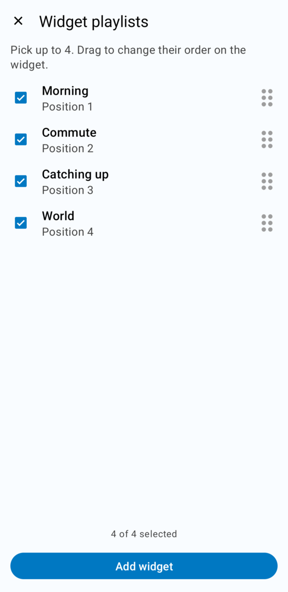

# Home screen

Start your playlists without opening the app.

## Playlists widget

1. Long-press an empty spot on your home screen and choose **Widgets**.
2. Find **Castlist** and drag the **Playlists** widget (4×1) onto the home screen.
3. Pick up to four playlists. Drag them by the handle to set their order on the widget, then tap **Add widget**.

Using it:

- **Tap a tile** to start that playlist from the top.
- The tile of the playlist that is playing turns into a **pause** button. Tap it to pause.
- Tap another tile to switch playlists.
- A playlist with nothing to play says so; tapping it opens the Playlists tab.

The widget adapts to its size: four compact tiles on a narrow screen (like the outer screen of a foldable), wider tiles when there is room. You can resize it like any widget. If it is too narrow for all your playlists, it shows the first ones.

To change the playlists later, long-press the widget and open its settings (on Pixel phones: the pencil or **Widget settings**).

The widget's colors follow your wallpaper on Android 12 and later.

## A playlist as a home screen icon

In a playlist, open the menu (⋮) and choose **Add to home screen**. Your launcher asks you to confirm and places an icon with the playlist's name. Tapping it starts the playlist without opening the app.

If you rename the playlist, the icon follows. If you delete the playlist, the icon is greyed out.

## App shortcuts

Long-press the Castlist icon to start one of your first playlists directly. Most launchers only show four shortcuts, and AntennaPod's own Queue and Episodes shortcuts come first, so you will usually see your first two playlists. Reorder your playlists in the Playlists tab to choose which ones.
