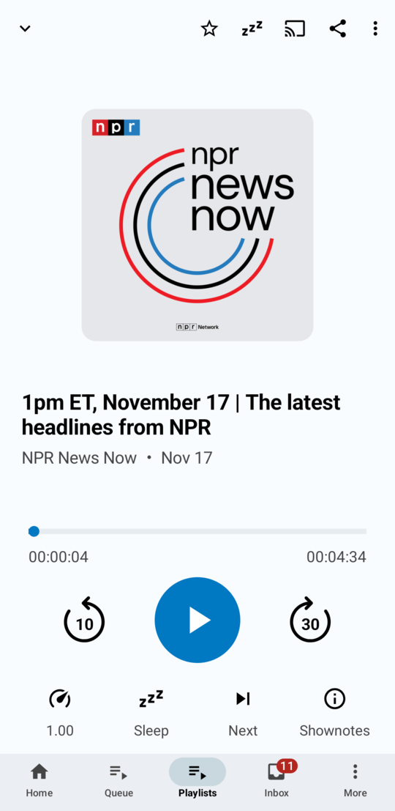

# Skip ad and the player

## Skip ad button

Many podcasts play ads of about the same length. In a podcast's settings, set an **Ad skip time** (for example 30 seconds). The player then shows a **Skip ad** button for that podcast that jumps ahead by that amount, separate from the regular fast-forward button. Set it back to 0 to hide the button.

## The modern player

The full-screen player has a new look: smaller artwork, a bold episode title, and large, well-spaced controls (rewind, play, fast-forward), with speed, sleep timer, next episode and show notes in a labeled row below.

Prefer the original? Switch back any time in Settings → User interface → **Player style → Classic**.

On big screens and foldables the player rearranges itself; see [Foldables and big screens](foldables.md).
