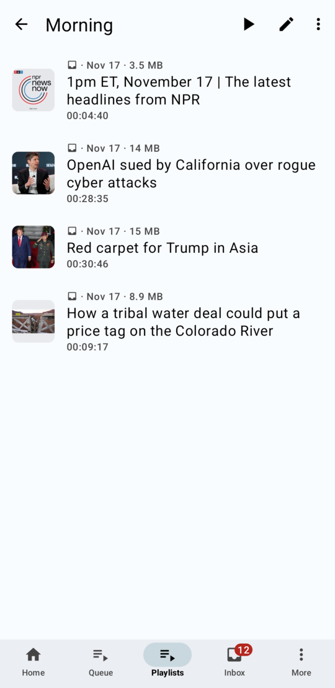
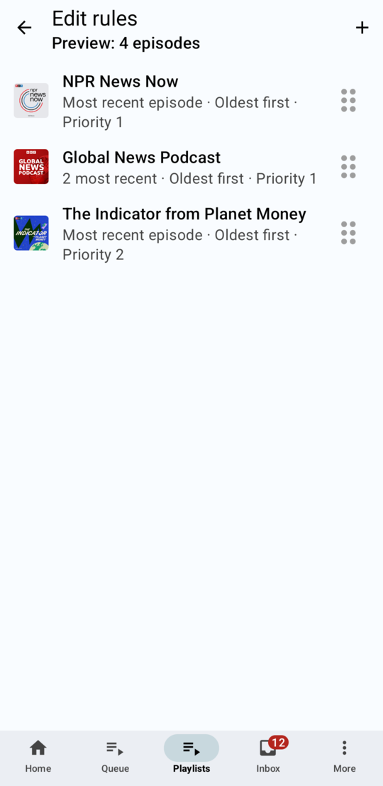

# Playlists

Next to the regular queue, you can create any number of playlists. A playlist is not a list of episodes you pick by hand: it is a set of **rules**, one per podcast, and the app works out the episodes for you. The playlist updates itself as new episodes come in and as you listen.

## Creating a playlist

1. Open the **Playlists** tab and tap **+**. Give the playlist a name.
2. Open the playlist and tap the **pencil** (Edit rules).
3. Tap **Add podcast**, choose a podcast and set its rule (below).
4. Add more podcasts the same way. Drag a rule to reorder it, swipe it away to remove it.

## Rules

Each rule says which episodes of one podcast go into the playlist:

| Setting | Choices | Notes |
|---|---|---|
| **Episodes** | All unplayed episodes, or a limit (for example 3) | |
| **Pick from** | Most recent, or Oldest unplayed | Only with a limit. "Most recent" looks at the newest episodes and keeps the unplayed ones among them. "Oldest unplayed" is for catching up on a series. |
| **Play order** | Oldest first, or Newest first | The order of this podcast's episodes inside the playlist |
| **Priority** | 1 to 10 | Priority 1 podcasts play first, then priority 2, and so on. Podcasts with the same priority follow the order of the rules. |

If a podcast has an [episode filter](episode-filter.md), the rule only picks episodes that pass it. "3 most recent" then means the 3 most recent episodes that pass the filter.

### Examples

- **Morning news:** the 2 most recent episodes of a news podcast (priority 1), then the most recent episode of a second news podcast (priority 1), then the next unplayed episode of a history series you are catching up on (priority 2).
- **Catching up on a series:** one rule, "4 oldest unplayed, oldest first". As you finish an episode, the next one in the series takes its place.
- **All new episodes from a set of podcasts:** one rule per podcast with "All unplayed episodes", same priority, newest first.

On a big screen the rules editor shows a live preview of the playlist next to the rules. On a phone, the rules screen shows how many episodes the playlist currently has.

## Playing a playlist

- In a playlist, the **play** button at the top plays it from the start.
- At the top of the Playlists tab, **play** starts with your first playlist that has episodes.

Playlists always play from the top. To hear one particular episode, open its podcast and play it from there; that uses the normal queue.

When an episode ends, the next one comes from the playlist, never from your queue, and playing from a playlist never adds episodes to the queue. Starting an episode from anywhere else (the queue, the inbox, a podcast page) switches back to the normal queue.

## When a playlist runs out

The app moves on to the next playlist, in the order of your Playlists tab, skipping empty ones. You can change this in Settings → Playback → **At the end of a playlist**:

- **Continue with the next playlist** (default)
- **Stop**

Either way, playback never falls back to the queue. Reorder your playlists by dragging them in the Playlists tab.

## Automatic downloads

In a playlist's menu (⋮), turn on **Auto-download episodes** to keep its episodes downloaded. Downloads follow your usual settings (Wi-Fi only, battery, and so on). These downloads:

- are not added to the queue,
- are kept when the app cleans up downloads to make room,
- do not count toward the episode limit in Settings → Downloads → Automatic download. That limit is left entirely to your podcasts' own automatic downloads.

A playlist episode is downloaded even if it was downloaded and removed before, for example by the official app before you moved to Castlist. The exception is an episode whose download you deleted or cancelled yourself in Castlist: it stays as it is. Download it again by hand if you change your mind. Downloads also start right after you edit a playlist's rules, not only at the next refresh.

To keep a playlist from filling your storage, every rule in a playlist with auto-download needs a number of episodes, up to 10 per podcast. "All unplayed episodes" is not available there. If a playlist already uses it, the app asks you to edit its rules first.

## Only downloaded episodes

In a playlist's menu (⋮), **Only downloaded episodes** makes the rules pick only from episodes that are already downloaded. This is handy for:

- listening offline or on mobile data: the playlist only contains what is on the phone;
- combining with a podcast's [episode filter](episode-filter.md), which decides what gets downloaded, so the playlist holds exactly the episodes you want.

A playlist with both **Auto-download episodes** and **Only downloaded episodes** still downloads its episodes, then shows them once they are downloaded.

## Android Auto

In a playlist's menu (⋮), **Show in Android Auto** adds it to a **Playlists** folder in Android Auto, right after "Continue listening". It is on for new playlists. Starting an episode from that folder plays the playlist, just like on the phone.

## On your home screen

Playlists can also be started from a widget, a home screen icon or the app's shortcuts. See [Home screen](home-screen.md).
